# Nano-Core DAG-граф загрузки (первые 20 процессов)

## Mermaid-диаграмма

```mermaid
graph TD
    %% ===== Wave 1: Критические процессы с нулевыми зависимостями =====
    log-ring-init["log-ring-init<br/>PID: 33<br/>priority: 1"]
    mem-heap-init["mem-heap-init<br/>PID: 25<br/>priority: 2"]
    sys-sched-init["sys-sched-init<br/>PID: 39<br/>priority: 3"]
    sys-irq-router["sys-irq-router<br/>PID: 40<br/>priority: 4"]
    drv-ata-reset["drv-ata-reset<br/>PID: 2<br/>priority: 1"]
    drv-apic-init["drv-apic-init<br/>PID: 10<br/>priority: 3"]
    drv-pci-enum["drv-pci-enum<br/>PID: 8<br/>priority: 5"]
    sec-entropy-pool["sec-entropy-pool<br/>PID: 20<br/>priority: 5"]
    drv-rtc-sync["drv-rtc-sync<br/>PID: 9<br/>priority: 8"]
    log-crash-dump["log-crash-dump<br/>PID: 38<br/>priority: 5"]

    %% ===== Wave 2: Зависимые от Wave 1 =====
    drv-ata-read["drv-ata-read<br/>PID: 3<br/>priority: 10"]
    sys-syscall-gate["sys-syscall-gate<br/>PID: 41<br/>priority: 10"]
    drv-kbd-init["drv-kbd-init<br/>PID: 4<br/>priority: 15"]
    drv-mouse-init["drv-mouse-init<br/>PID: 5<br/>priority: 15"]
    mem-page-alloc["mem-page-alloc<br/>PID: 26<br/>priority: 15"]

    %% ===== Wave 3: Зависимые от Wave 2 =====
    fs-erofs-mount["fs-erofs-mount<br/>PID: 11<br/>priority: 40<br/>⚠ critical"]
    fs-vfs-router["fs-vfs-router<br/>PID: 14<br/>priority: 35<br/>⚠ critical"]
    drv-vga-mode["drv-vga-mode<br/>PID: 6<br/>priority: 20"]
    net-stack-init["net-stack-init<br/>PID: 29<br/>priority: 20"]

    %% ===== Wave 4: Зависимые от Wave 3 =====
    fs-erofs-read["fs-erofs-read<br/>PID: 12<br/>priority: 45"]
    drv-fb-write["drv-fb-write<br/>PID: 7<br/>priority: 25"]
    fs-ext2-mount["fs-ext2-mount<br/>PID: 13<br/>priority: 42"]

    %% ===== Wave 5: Зависимые от Wave 4 =====
    fs-path-resolve["fs-path-resolve<br/>PID: 15<br/>priority: 50"]
    sec-sig-verify["sec-sig-verify<br/>PID: 19<br/>priority: 25<br/>⚠ critical"]
    fs-stat-worker["fs-stat-worker<br/>PID: 16<br/>priority: 55"]

    %% ===== Wave 6 =====
    fs-dir-enum["fs-dir-enum<br/>PID: 17<br/>priority: 58"]
    fs-journal-replay["fs-journal-replay<br/>PID: 18<br/>priority: 60"]

    %% ===== Edges (зависимости) =====
    log-ring-init --> fs-vfs-router
    log-ring-init --> fs-erofs-mount
    log-ring-init --> sec-sig-verify
    mem-heap-init --> fs-erofs-mount
    mem-heap-init --> mem-page-alloc
    sys-sched-init --> sys-syscall-gate
    sys-irq-router --> drv-kbd-init
    drv-ata-reset --> drv-ata-read
    drv-ata-reset --> fs-erofs-mount
    drv-pci-enum --> drv-vga-mode
    drv-pci-enum --> drv-net-rtl8139
    drv-vga-mode --> drv-fb-write
    sys-syscall-gate --> sec-seccomp-filter
    fs-erofs-mount --> fs-erofs-read
    fs-erofs-mount --> fs-ext2-mount
    fs-erofs-mount --> fs-vfs-router
    fs-vfs-router --> fs-path-resolve
    fs-vfs-router --> fs-stat-worker
    fs-path-resolve --> fs-dir-enum
    fs-ext2-mount --> fs-journal-replay
    fs-erofs-read --> sec-sig-verify
    fs-erofs-read --> ui-keymap-load

    %% ===== Styling =====
    classDef critical fill:#ff6b6b,stroke:#c92a2a,stroke-width:2px,color:#fff
    classDef wave1 fill:#74c0fc,stroke:#1971c2,color:#000
    classDef wave2 fill:#a5d8ff,stroke:#1971c2,color:#000
    classDef wave3 fill:#b2f2bb,stroke:#2b8a3e,color:#000
    classDef wave4 fill:#d0bfff,stroke:#5f3dc4,color:#000
    classDef wave5 fill:#ffd8a8,stroke:#d9480f,color:#000
    classDef wave6 fill:#fcc2d7,stroke:#c2255c,color:#000

    class log-ring-init,mem-heap-init,sys-sched-init,sys-irq-router,drv-ata-reset,drv-apic-init,drv-pci-enum,sec-entropy-pool,drv-rtc-sync,log-crash-dump wave1
    class drv-ata-read,sys-syscall-gate,drv-kbd-init,drv-mouse-init,mem-page-alloc wave2
    class fs-erofs-mount,fs-vfs-router,drv-vga-mode,net-stack-init wave3
    class fs-erofs-read,drv-fb-write,fs-ext2-mount wave4
    class fs-path-resolve,sec-sig-verify,fs-stat-worker wave5
    class fs-dir-enum,fs-journal-replay wave6

    class fs-erofs-mount,fs-vfs-router,sec-sig-verify critical
```

## Пояснения

### Wave 1 (параллельно, ~5 мс)
- `log-ring-init` — инициализация кольцевого буфера логов (критична)
- `mem-heap-init` — инициализация выделителя памяти (критична)
- `sys-sched-init` — планировщик (критична)
- `sys-irq-router` — маршрутизация прерываний (критична)
- `drv-ata-reset` — сброс ATA-контроллера
- `drv-apic-init` — APIC
- `drv-pci-enum` — перечисление PCI
- `sec-entropy-pool` — энтропийный пул
- `drv-rtc-sync` — синхронизация RTC
- `log-crash-dump` — обработчик crash dump

### Wave 2 (после Wave 1)
- `drv-ata-read` — чтение секторов диска
- `sys-syscall-gate` — ворота системных вызовов
- `drv-kbd-init` — клавиатура
- `drv-mouse-init` — мышь
- `mem-page-alloc` — выделение страниц

### Wave 3
- `fs-erofs-mount` — монтирование EROFS (ждёт `drv-ata-reset` + `mem-heap-init`)
- `fs-vfs-router` — маршрутизация VFS
- `drv-vga-mode` — видеорежим
- `net-stack-init` — сетевой стек

### Wave 4–6
- Чтение файлов, монтирование ext2,journal replay, перечисление директорий
